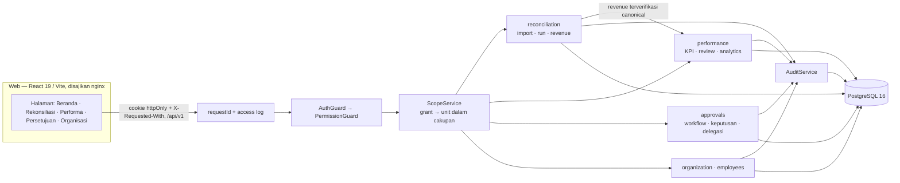
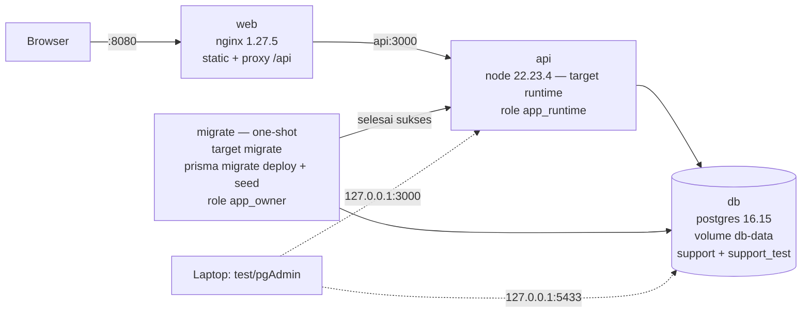
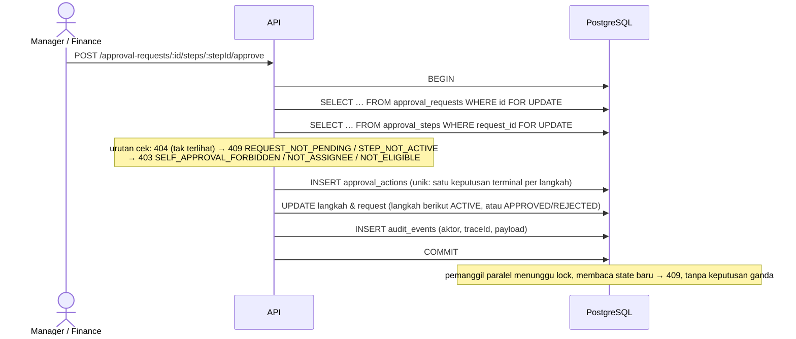

# Arsitektur

Kondisi **final (Phase 07)**: semua modul domain terimplementasi dan diuji ([test-report.md](test-report.md)). Aturan bisnis: [business-rules.md](business-rules.md). Kontrak API: [api.md](api.md).

## 1. Gambaran solusi & modul
Modular monolith: satu API NestJS dengan modul domain terpisah, satu PostgreSQL, satu Web React. Dipilih karena skala tugas (satu tim, waktu terbatas) dan kebutuhan transaksi ACID lintas modul (keputusan approval + audit; run rekonsiliasi + canonical + audit) yang lebih sederhana dalam satu database dibanding layanan terpisah.



Alur request: middleware `x-request-id` + log akses → validasi DTO (field asing ditolak) → `AuthGuard` (401) → `PermissionGuard` (403) → `ScopeService` (resource di luar cakupan = 404) → service domain → transaksi DB. Frontend tidak memutuskan otorisasi maupun kalkulasi; tombol hanya disembunyikan untuk kenyamanan.

| Modul backend (`backend/src/modules`) | Tanggung jawab |
|---|---|
| `auth`, `access` | Login, cookie sesi, rate limit login, permission per peran, `ScopeService` |
| `organization`, `employees` | Master unit & karyawan dalam cakupan, rename unit (audit) |
| `reconciliation` | Import CSV, matching v1/v2, run idempoten, canonical, `RevenueService` |
| `performance` | Periode, KPI, preview & finalisasi review, `ReviewAccessPolicy`, analitik RPE & distribusi skor |
| `approvals` | Draf, submit dengan snapshot workflow, approve/reject/delegate berkunci, inbox, audit trail |
| `audit`, `health` | Insert audit dalam transaksi pemanggil; `/health/live`, `/health/ready` |

## 2. Struktur repository
```
backend/      NestJS API (paket pnpm "api"): src/modules, src/common, src/database (PrismaService, seed),
              prisma/ (schema + 4 migration), test/integration (PostgreSQL nyata), Dockerfile (build/migrate/runtime)
frontend/     React + Vite (paket "web"): src/{components,features,lib,routes}, e2e/ (Playwright), nginx.conf, Dockerfile
docs/         deliverable: arsitektur, API, aturan bisnis, matrix, test report, demo script, presentation/
docker/       init script PostgreSQL (role & database), impor server pgAdmin
samples/      fixture test-data + expected results (tidak diubah)
scripts/      e2e-isolated.sh, prepare-demo-recon.mjs, generate-erd.py, phase00_crosscheck.py
```

## 3. Deployment


| Service | Image | Peran | Port host |
|---|---|---|---|
| `db` | `postgres:16.15-alpine` | Volume `db-data`; init script membuat role & database `support` + `support_test` (hanya saat volume kosong) | `127.0.0.1:5433` |
| `migrate` | `support-function-migrate:local` (target `migrate`) | One-shot: `prisma migrate deploy` lalu seed (role owner). Gagal → `api` tidak start | — |
| `api` | `support-function-api:local` (target `runtime`) | NestJS dengan role runtime; dependency produksi + Prisma Client saja (tanpa CLI/test tool) | `127.0.0.1:3000` |
| `web` | `nginx:1.27.5-alpine` + build Vite | Static SPA (fallback `index.html`), `/api/` di-proxy ke `api:3000` | `8080` |

Healthcheck: `db` via `pg_isready`, `api` via `/api/v1/health/ready` (query DB ≤ 2 dtk, 503 bila gagal), `web` menunggu `api` healthy. Image dibangun di Linux (Prisma engine musl; arm64/amd64). Semua respons membawa `x-request-id`; error `{ code, message, requestId, details? }`; log akses API: `requestId method path status durasi` (peringatan bila ≥ 2 dtk atau koneksi ditutup klien sebelum selesai).

Role database:
- `app_owner` — pemilik skema, dipakai migration dan seed. Bukan superuser.
- `app_runtime` — dipakai API. DML pada tabel aplikasi, **hanya** SELECT/INSERT pada `audit_events`, tanpa akses `_prisma_migrations`. Bukan superuser/owner.

## 4. Data scoping: di query aplikasi, bukan PostgreSQL RLS
Row-level scoping diterapkan **di lapisan aplikasi**. PostgreSQL Row-Level Security (RLS) **tidak** dipakai.

1. `ScopeService.resolve(actor, permission)` menghitung himpunan unit dari grant aktor yang memberi permission itu (recursive CTE ke subtree bila `include_descendants`, seluruh organisasi bila grant tanpa unit). `resolveForRole` dipakai approval: hanya grant peran langkah.
2. Setiap list/agregat memfilter `unit_id IN (unit dalam cakupan)`; detail/mutasi memanggil `assertUnit` → 404 bila di luar cakupan (keberadaan data tidak dibocorkan). Filter dari klien hanya mempersempit.
3. Review memakai `ReviewAccessPolicy` (D-42): unit rumah **dan seluruh** unit sumber revenue KPI harus dalam cakupan.
4. Role/scope tidak pernah dibaca dari token; grant dimuat ulang dari DB per request.

Konsekuensi: keamanan baris bergantung pada setiap query aplikasi memakai `ScopeService`; dijaga oleh integration test scope/isolasi (lintas cabang, lintas organisasi, grant terikat, manipulasi input) dan E2E Manager B. Lapisan database hanya menjamin pemisahan role dan audit append-only untuk `app_runtime`. RLS adalah opsi roadmap bila ada klien database selain API.

## 5. ERD (dihasilkan dari `backend/prisma/schema.prisma` final)
Dibuat dengan `python3 -I scripts/generate-erd.py`; nama tabel/kolom sesuai database. Constraint yang tidak terlihat di ERD ada di §6.

```mermaid
erDiagram
  organizations {
    uuid id PK
    text external_key
    text name
    timestamptz created_at
  }
  org_units {
    uuid id PK
    uuid organization_id FK
    uuid parent_id FK "nullable"
    enum type
    text external_key
    text name
    timestamptz created_at
  }
  users {
    uuid id PK
    text external_key
    text email
    text password_hash
    bool active
    timestamptz created_at
  }
  user_access_grants {
    uuid id PK
    uuid user_id FK
    enum role
    uuid organization_id FK
    uuid unit_id FK "nullable"
    bool include_descendants
    timestamptz created_at
  }
  employees {
    uuid id PK
    uuid organization_id FK
    text external_key
    text name
    timestamptz created_at
  }
  employee_assignments {
    uuid id PK
    uuid employee_id FK
    uuid organization_id
    uuid unit_id FK
    date start_date
    date end_date_exclusive "nullable"
    bool is_primary
    timestamptz created_at
  }
  review_periods {
    uuid id PK
    uuid organization_id FK
    text external_key
    date start_date
    date end_date_exclusive
    text timezone
    timestamptz created_at
  }
  kpi_assignments {
    uuid id PK
    uuid organization_id
    uuid employee_id FK
    uuid period_id FK
    text external_key "nullable"
    text name
    enum source
    uuid unit_id FK "nullable"
    numeric weight
    numeric target
    numeric actual "nullable"
    timestamptz created_at
    timestamptz updated_at
  }
  performance_reviews {
    uuid id PK
    uuid organization_id
    uuid employee_id FK
    uuid period_id FK
    uuid unit_id FK
    enum status
    numeric total_score "nullable"
    text formula_version
    jsonb provenance
    timestamptz calculated_at
    timestamptz finalized_at "nullable"
    uuid finalized_by "nullable"
  }
  review_items {
    uuid id PK
    uuid review_id FK
    uuid kpi_assignment_id FK
    text kpi_name
    enum source
    uuid unit_id FK "nullable"
    numeric weight
    numeric target
    numeric actual
    numeric achievement
    numeric capped_achievement
    numeric weighted_score
  }
  financial_transactions {
    uuid id PK
    uuid organization_id FK
    uuid unit_id FK
    enum side
    text account_id
    text source_transaction_id
    text reference
    date transaction_date
    numeric amount
    text currency
    text transaction_type
    text payload_hash
    timestamptz created_at
  }
  transaction_datasets {
    uuid id PK
    uuid organization_id FK
    uuid unit_id FK
    text account_id
    enum side
    text fingerprint
    int row_count
    text source_filename "nullable"
    uuid imported_by "nullable"
    timestamptz created_at
  }
  dataset_transactions {
    uuid dataset_id FK
    uuid transaction_id FK
  }
  reconciliation_runs {
    uuid id PK
    uuid organization_id
    uuid unit_id
    text account_id
    uuid internal_dataset_id FK
    uuid external_dataset_id FK
    text rule_version
    int date_tolerance_days
    numeric amount_tolerance
    enum status
    uuid created_by "nullable"
    timestamptz created_at
    timestamptz completed_at "nullable"
  }
  reconciliation_results {
    uuid id PK
    uuid run_id FK
    text match_key
    text reference
    enum status
    text reason "nullable"
    numeric internal_amount_total
    numeric external_amount_total
    numeric amount_difference "nullable"
  }
  reconciliation_result_items {
    uuid result_id FK
    uuid run_id
    uuid transaction_id FK
    enum side
  }
  canonical_reconciliations {
    uuid internal_transaction_id PK,FK
    enum transaction_side
    uuid run_id FK
    uuid result_id FK
    timestamptz selected_at
  }
  workflow_definitions {
    uuid id PK
    uuid organization_id FK
    text external_key
    int version
    text type
    text currency
    bool self_approval
    bool active
    timestamptz created_at
  }
  workflow_steps {
    uuid id PK
    uuid workflow_id FK
    int step_order
    enum role
    enum condition_type
    numeric condition_amount "nullable"
  }
  approval_requests {
    uuid id PK
    uuid organization_id FK
    uuid unit_id FK
    text external_key "nullable"
    uuid requester_user_id FK
    uuid workflow_id FK
    text title
    text reason
    jsonb workflow_snapshot "nullable"
    numeric amount
    text currency
    enum status
    int current_step_order "nullable"
    int version
    timestamptz submitted_at "nullable"
    timestamptz decided_at "nullable"
    timestamptz created_at
    timestamptz updated_at
  }
  approval_steps {
    uuid id PK
    uuid request_id FK
    uuid workflow_step_id FK
    int step_order
    enum role
    enum status
    uuid assignee_user_id FK "nullable"
    uuid decided_by FK "nullable"
    timestamptz decided_at "nullable"
  }
  approval_actions {
    uuid id PK
    uuid step_id FK
    uuid request_id FK
    uuid actor_user_id FK
    enum action
    uuid delegate_to_user_id FK "nullable"
    text comment "nullable"
    timestamptz created_at
  }
  audit_events {
    BigInt id PK
    uuid organization_id
    text entity_type
    uuid entity_id
    uuid actor_user_id "nullable"
    text event_type
    jsonb payload
    text trace_id "nullable"
    timestamptz created_at
  }
  approval_requests ||--o{ approval_actions : "request"
  approval_requests ||--o{ approval_steps : "request"
  approval_steps ||--o{ approval_actions : "step"
  employees ||--o{ employee_assignments : "employee"
  employees ||--o{ kpi_assignments : "employee"
  employees ||--o{ performance_reviews : "employee"
  financial_transactions ||--o{ canonical_reconciliations : "transaction"
  financial_transactions ||--o{ dataset_transactions : "transaction"
  financial_transactions ||--o{ reconciliation_result_items : "transaction"
  kpi_assignments ||--o{ review_items : "kpi"
  org_units |o--o{ kpi_assignments : "unit"
  org_units |o--o{ org_units : "parent"
  org_units |o--o{ review_items : "unit"
  org_units |o--o{ user_access_grants : "unit"
  org_units ||--o{ approval_requests : "unit"
  org_units ||--o{ employee_assignments : "unit"
  org_units ||--o{ financial_transactions : "unit"
  org_units ||--o{ performance_reviews : "unit"
  org_units ||--o{ transaction_datasets : "unit"
  organizations ||--o{ approval_requests : "organization"
  organizations ||--o{ employees : "organization"
  organizations ||--o{ financial_transactions : "organization"
  organizations ||--o{ org_units : "organization"
  organizations ||--o{ review_periods : "organization"
  organizations ||--o{ transaction_datasets : "organization"
  organizations ||--o{ user_access_grants : "organization"
  organizations ||--o{ workflow_definitions : "organization"
  performance_reviews ||--o{ review_items : "review"
  reconciliation_results ||--o{ canonical_reconciliations : "result"
  reconciliation_results ||--o{ reconciliation_result_items : "result"
  reconciliation_runs ||--o{ canonical_reconciliations : "run"
  reconciliation_runs ||--o{ reconciliation_results : "run"
  review_periods ||--o{ kpi_assignments : "period"
  review_periods ||--o{ performance_reviews : "period"
  transaction_datasets ||--o{ dataset_transactions : "dataset"
  transaction_datasets ||--o{ reconciliation_runs : "externalDataset"
  transaction_datasets ||--o{ reconciliation_runs : "internalDataset"
  users |o--o{ approval_actions : "delegateTo"
  users |o--o{ approval_steps : "assignee"
  users |o--o{ approval_steps : "decider"
  users ||--o{ approval_actions : "actor"
  users ||--o{ approval_requests : "requester"
  users ||--o{ user_access_grants : "user"
  workflow_definitions ||--o{ approval_requests : "workflow"
  workflow_definitions ||--o{ workflow_steps : "workflow"
  workflow_steps ||--o{ approval_steps : "workflowStep"
```



## 6. Constraint penting
| Constraint | Implementasi |
|---|---|
| Parent org unit satu organisasi | FK komposit `(parent_id, organization_id)` → `org_units(id, organization_id)` |
| Penempatan primer tidak overlap | `EXCLUDE USING gist (employee_id WITH =, daterange(start_date, end_date_exclusive) WITH &&) WHERE is_primary` (custom SQL migration) |
| Identitas transaksi sumber unik | `UNIQUE (organization_id, side, account_id, source_transaction_id)` |
| Identitas dataset | `UNIQUE (organization_id, fingerprint)` |
| Run unik | `UNIQUE (internal_dataset_id, external_dataset_id, rule_version)` |
| Satu canonical per transaksi | PK `canonical_reconciliations.internal_transaction_id` |
| Transaksi satu kali per run | `UNIQUE (run_id, transaction_id)` pada result items (via run_id terdenormalisasi) |
| Satu keputusan terminal per step | `UNIQUE (step_id) WHERE action IN ('APPROVE','REJECT')` |
| Grant konsisten | FK komposit unit ↔ organisasi + unique `(user, role, org, unit) NULLS NOT DISTINCT` |
| Audit append-only | `REVOKE UPDATE, DELETE, TRUNCATE ON audit_events FROM app_runtime` + trigger tolak UPDATE/DELETE (berlaku juga untuk owner) |
| Canonical hanya transaksi INTERNAL | kolom `transaction_side` CHECK = INTERNAL + FK komposit `(id, side)` |
| Konsistensi org lain | FK komposit `(x_id, organization_id)` pada assignment, KPI, review, transaksi, dataset, request |
| Domain | CHECK amount > 0, currency IDR, type REVENUE, target > 0, bobot (0,100], interval tanggal valid |
| Nominal | `NUMERIC(20,2)` untuk uang, `NUMERIC` tanpa skala untuk hasil turunan |


## 7. Alur Finance → HR (revenue terverifikasi → KPI/RPE)
```mermaid
sequenceDiagram
  actor F as Finance
  actor H as HR
  participant API
  participant DB as PostgreSQL
  F->>API: POST /datasets/import (internal & eksternal, per unit+akun)
  API->>DB: transaksi canonical (ON CONFLICT) + dataset fingerprint — idempoten
  F->>API: POST /reconciliation-runs (dataset, rule v1/v2)
  API->>DB: advisory lock identitas run → hasil + item + canonical + audit (1 transaksi)
  Note over DB: canonical = run terbaru per transaksi internal;<br/>revenue terverifikasi = transaksi MATCHED pada run canonical
  H->>API: POST /reviews/calculate (preview, tidak disimpan)
  API->>DB: revenue unit rumah + turunan (1 statement) → skor KPI
  H->>API: POST /reviews/:id/finalize
  API->>DB: lock review → lock KPI → validasi bobot 100 → revenue + provenance run → snapshot FINAL + audit
  H->>API: GET /analytics/revenue-per-employee
  API->>DB: revenue terverifikasi ÷ (employee-days ÷ hari periode) per unit dalam cakupan
```

## 8. Transaksi approval & audit

Submit dan delegasi memakai lock yang sama. Submit menyimpan snapshot workflow (langkah sesuai nominal). Delegasi hanya mengganti `assignee` langkah aktif tanpa menambah grant; penerima divalidasi ulang saat bertindak. `audit_events` append-only untuk `app_runtime` (REVOKE + trigger); owner/administrator database **tidak** dibatasi oleh mekanisme ini.

## 9. Concurrency (ringkas)
| Operasi | Mekanisme | Diuji |
|---|---|---|
| Keputusan approval | `FOR UPDATE` request → langkah; unique partial index (satu ACTIVE, satu keputusan terminal) sebagai jaring kedua | Dua instance aplikasi, transaksi pertama ditahan sebelum commit, `pg_locks` memastikan yang kedua menunggu |
| Run rekonsiliasi | `pg_advisory_xact_lock` per identitas run + cek ulang + `UNIQUE (internal, external, rule)` | Dua pool koneksi paralel → 1 run |
| Import | Unique fingerprint dataset + identitas transaksi, `ON CONFLICT` lalu bandingkan payload hash | Import identik paralel |
| Finalisasi review | Lock review → lock KPI; perubahan KPI mengunci review yang sama | Finalisasi bersamaan |

## 10. Kontrak API & migration
Prefix `/api/v1`; daftar endpoint mengikuti kontrak API awal rencana implementasi, dengan **tambahan resmi** berikut (detail di [api.md](api.md)):

| Endpoint | Alasan |
|---|---|
| `POST /auth/logout` | Menghapus cookie sesi httpOnly (tidak bisa dihapus JavaScript) |
| `PATCH /org-units/:id` | Mutasi master pertama untuk membuktikan scope + audit pada perubahan data; dipakai UI Admin |
| `GET /org-units/:id`, `GET /employees/:id`, `GET /employees/summary` | Detail dan agregat ber-scope untuk master data |
| `GET /reconciliation-runs`, `GET /reconciliation-runs/:id` | Daftar & detail run untuk UI (Manager perlu menemukan run cabangnya) |
| `GET /reviews/:id` | Detail review untuk pembaca tanpa `review.manage` (Manager) |
| `GET /approval-requests/options`, `PATCH /approval-requests/:id`, `GET …/steps/:stepId/delegates` | Form pengajuan (unit + pratinjau jalur), ubah draf, calon delegasi yang sah |

Migration Phase 05 `20261031000300_approval_workflow`: kolom `approval_requests.reason` & `workflow_snapshot`; CHECK panjang teks, DRAFT ⇔ belum submit, tersubmit wajib snapshot, PENDING ⇔ langkah aktif, status akhir ⇔ `decided_at`; unique "satu langkah ACTIVE per pengajuan" & "satu workflow aktif per organisasi+tipe".

Migration Phase 04 `20261031000200_performance_review_unit`: kolom `performance_reviews.unit_id` (unit rumah, dasar scope) + FK komposit unit↔organisasi + CHECK `FINAL ⇔ total_score NOT NULL`; `review_items.unit_id` (unit sumber revenue snapshot). Dibuat dengan `prisma migrate diff --from-schema-datamodel <schema lama> --to-schema-datamodel <schema baru>` sehingga tidak ada usulan DROP constraint manual.

Sesi browser: cookie httpOnly `SameSite=Strict` + header CSRF untuk mutasi; klien API memakai Bearer. Rate limit login in-memory per proses API (lihat business-rules §1.4a). DTO final didokumentasikan di `docs/api.md`/OpenAPI pada phase terkait. Nominal sebagai string desimal; list berpagination (default 20, maks. 100).
